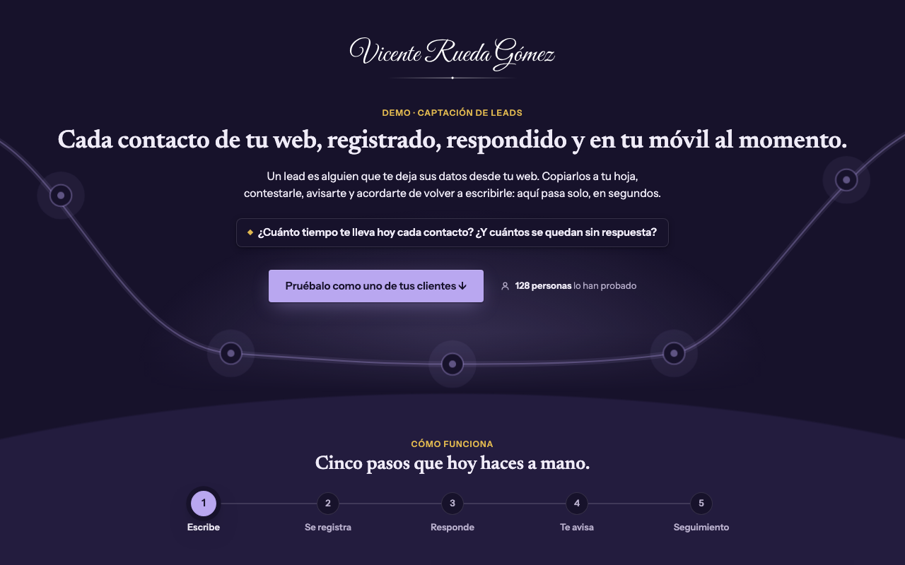
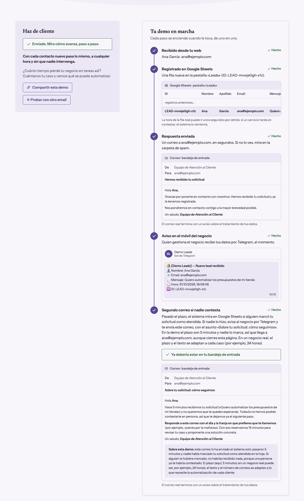
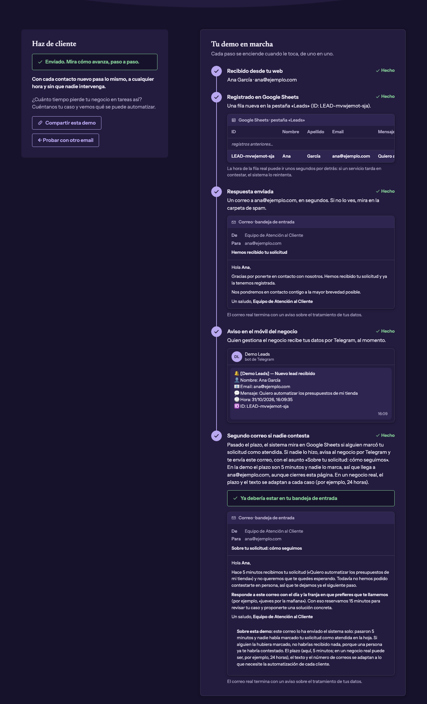
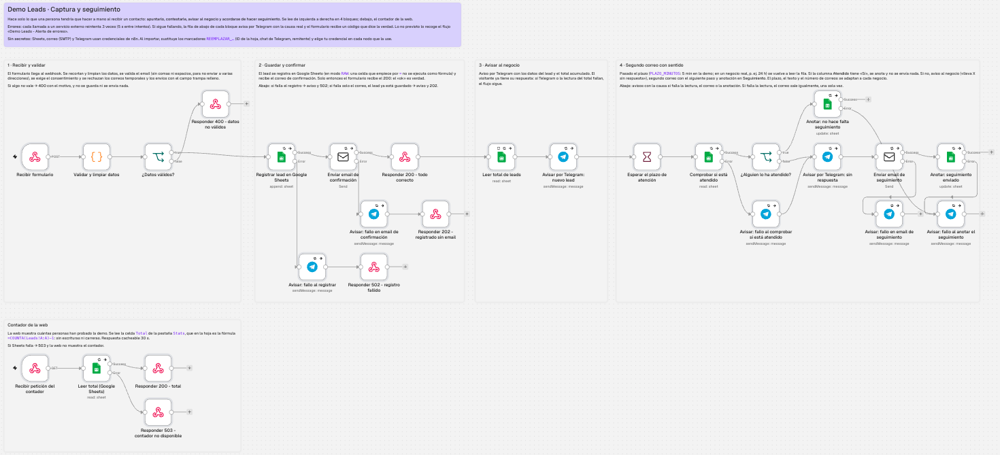

# Demo Leads: captación automatizada con n8n

**▶ Pruébala en vivo: [demo-leads.vicenterueda.com](https://demo-leads.vicenterueda.com)**

Una web con un formulario y un flujo de automatización detrás. Cuando alguien rellena el formulario, **el sistema hace solo lo que una persona tendría que hacer a mano**: apuntar el contacto, contestarle, avisar al negocio y acordarse de hacer seguimiento.

La web no solo recoge el contacto: **enseña paso a paso lo que ocurre** (la fila en la hoja, los correos, el aviso al móvil y el segundo correo) para que cualquiera, sin conocimientos técnicos, entienda qué se automatiza.

<table>
  <tr>
    <th>Modo claro</th>
    <th>Modo oscuro (automático, según el sistema)</th>
  </tr>
  <tr>
    <td></td>
    <td></td>
  </tr>
  <tr>
    <td></td>
    <td></td>
  </tr>
</table>

<sub>Capturas en modo simulación, con datos de ejemplo.</sub>

## Objetivo

Demostrar, con un caso real y completo, que sé:

- Diseñar un flujo de automatización con **n8n** que conecta varios servicios (webhook, Google Sheets, correo por SMTP y Telegram).
- Gestionar **los errores con honestidad**: reintentos, avisos con la causa real y códigos HTTP que dicen al visitante lo que ha pasado de verdad.
- Tratar **datos personales** con criterio: consentimiento guardado, minimización y anonimización automática.
- **Empaquetar y desplegar** una web estática con Docker (nginx), sin dejar secretos en el repositorio.

## Esquema del flujo

```
 Navegador                          n8n                                   Servicios
 ─────────                          ───                                   ─────────
 Formulario ──POST──►  1. Recibir formulario (webhook)
                       2. Validar y limpiar datos ──► datos no válidos, sin consentimiento
                          o correo temporal ──► responde 400
                       3. Registrar en Google Sheets ──► Google Sheets (pestaña «Leads»)
                              │ falla ──► aviso por Telegram ──► responde 502
                       4. Email de confirmación ───────────────► Correo (SMTP)
                              │ falla ──► aviso por Telegram ──► responde 202
                       5. Responde 200 al formulario  (todo guardado y enviado)
                       6. Aviso por Telegram: nuevo lead ──────► Telegram
                       7. Espera el plazo (5 minutos en la demo; se configura)
                       8. Vuelve a leer la fila del lead ──────► Google Sheets
                              │ «Atendido» = Sí ──► anota «No hace falta» y no envía nada
                              │ vacío ──► aviso por Telegram («lleva X sin respuesta»)
                              │           ──► segundo email, con el siguiente paso ──► Correo (SMTP)
                              │           ──► anota «Enviado» en «Seguimiento»
                              │ falla cualquier paso ──► aviso por Telegram con la causa

 Contador:   GET /demo-count ──► lee la celda «Total» de la pestaña «Stats» ──► responde {total}

 Cada día a las 04:00 (flujo de limpieza):  lee «Leads» ──► elige los de más de 30 días
                                      ──► sustituye nombre, apellido, email y mensaje por «(borrado)»
                                      ──► resumen por Telegram

 Cualquier fallo no previsto en cualquier flujo ──► flujo de errores ──► aviso por Telegram
```

Así se ve el flujo principal en n8n. Cada bloque lleva una nota en el lienzo que explica qué hace:



## Qué hace cada nodo

Los tres flujos están en `n8n/`. Los nodos que llaman a un servicio externo reintentan 3 veces, con 5 segundos entre intentos.

### Captura y seguimiento (`demo-leads-captura.json`: 27 nodos y 6 notas)

| Bloque | Nodo | Qué hace |
|---|---|---|
| 1 · Recibir y validar | Recibir formulario | Webhook `POST /webhook/demo-leads`. Solo acepta peticiones desde el dominio de la demo (CORS). |
| | Validar y limpiar datos | Recorta longitudes, quita caracteres de control, valida el email (sin comas ni espacios), exige el consentimiento, rechaza correos temporales y el campo trampa, crea el ID del lead y prepara copias con el HTML escapado. |
| | ¿Datos válidos? | Separa los envíos válidos de los que no lo son. |
| | Responder 400 - datos no válidos | Devuelve el motivo para que la web lo muestre junto al campo correspondiente. No se guarda nada. |
| 2 · Guardar y confirmar | Registrar lead en Google Sheets | Añade la fila a la pestaña `Leads`, con la fecha del consentimiento. Escribe en modo `RAW`, así que una celda que empiece por `=` no se ejecuta como fórmula. |
| | Enviar email de confirmación | Correo al cliente por SMTP: «Hemos recibido tu solicitud». |
| | Responder 200 - todo correcto | El «ok» llega aquí, solo cuando el lead está guardado y el correo enviado. |
| | Avisar: fallo al registrar → Responder 502 | Si falla el registro: aviso por Telegram con la causa, y la web dice que no se ha guardado nada. |
| | Avisar: fallo en email de confirmación → Responder 202 | Si solo falla el correo: el lead ya está guardado, llega el aviso y la web explica que no se pudo enviar el correo. |
| 3 · Avisar al negocio | Leer total de leads | Lee el total acumulado para incluirlo en el aviso. Si falla, el flujo sigue. |
| | Avisar por Telegram: nuevo lead | Aviso al negocio con el nombre, el email, el principio del mensaje, la hora y el ID. |
| 4 · Segundo correo con sentido | Esperar el plazo de atención | Espera `PLAZO_MINUTOS` (5 en la demo). Mientras tanto, el negocio puede marcar el lead como atendido en la hoja. |
| | Comprobar si está atendido | Vuelve a leer la fila del lead por su ID. |
| | ¿Alguien lo ha atendido? | Mira la columna `Atendido`. |
| | Anotar: no hace falta seguimiento | Si está atendido, lo anota en `Seguimiento` y no se envía nada. |
| | Avisar por Telegram: sin respuesta | Si no lo está, avisa al negocio de que el contacto «lleva 5 minutos sin respuesta». |
| | Enviar email de seguimiento | Segundo correo al cliente: cita su mensaje y le pide el día y la franja para llamarle. |
| | Anotar: seguimiento enviado | Lo anota en `Seguimiento`. |
| | Avisar: fallo al comprobar si está atendido | Si falla la lectura: aviso con la causa, y el seguimiento sale igualmente, una sola vez. |
| | Avisar: fallo en email de seguimiento | Aviso con la causa si el segundo correo no sale. |
| | Avisar: fallo al anotar el seguimiento | Aviso con la causa si no se puede escribir en `Seguimiento`. |
| Contador de la web | Recibir petición del contador | Webhook `GET /webhook/demo-count`, con el mismo CORS. |
| | Leer total (Google Sheets) | Lee la celda `Total` de la pestaña `Stats`. |
| | Responder 200 - total | Devuelve `{"total": N}`. El navegador puede guardar la respuesta 30 segundos. |
| | Responder 503 - contador no disponible | Si Sheets falla, la web simplemente no muestra el contador. |

### Alerta de errores (`demo-leads-errores.json`)

| Nodo | Qué hace |
|---|---|
| Se produce un error en un workflow | Se activa cuando cualquiera de los otros dos flujos falla de una forma no prevista. |
| Avisar por Telegram: workflow caído | Envía el nombre del flujo, el nodo que falló, el error y el enlace a la ejecución. |

### Limpieza de datos personales (`demo-leads-limpieza.json`)

| Nodo | Qué hace |
|---|---|
| Cada día a las 04:00 | Programación diaria, en hora de Madrid. |
| Leer todos los leads | Lee la pestaña `Leads`. |
| Elegir leads de más de 30 días | Deja pasar solo las filas con más de 30 días que aún no estén anonimizadas. |
| Anonimizar datos personales | Sustituye nombre, apellido, email y mensaje por «(borrado)». La fila se conserva, así que el contador no baja. |
| Avisar por Telegram: resumen de la limpieza | Indica cuántos leads se han anonimizado. |

## Decisiones de diseño

- **El visitante recibe el «ok» solo cuando el contacto está guardado y el primer correo enviado.** Si falla el registro, recibe un 502; si solo falla el correo, un 202 («guardado, pero sin email»).
- **Ningún fallo pasa en silencio.** Cada fallo previsto avisa por Telegram con la causa real (por ejemplo, `Forbidden` si la hoja no da permiso, o `getaddrinfo ENOTFOUND` si el servidor de correo no existe), y lo no previsto lo recoge el flujo de errores.
- **El segundo correo solo sale si nadie ha atendido el contacto.** Pasado el plazo, el flujo vuelve a leer la fila: si el negocio marcó «Sí» en `Atendido`, no se envía nada; si no, avisa al negocio por Telegram y manda al cliente su siguiente paso. El plazo es una constante (`PLAZO_MINUTOS`: 5 en la demo; un negocio real usaría, por ejemplo, 1440 = 24 h). El texto y el número de correos se adaptan a lo que necesite cada negocio.
- **La prueba del consentimiento queda guardada:** la casilla de la política se envía con el formulario y el flujo anota la fecha y la hora en la columna `Consentimiento`. Sin ella, responde 400.
- **Los correos temporales se rechazan con una lista de dominios desechables** (en el nodo de validación). Es orientativa: no los caza todos, porque cada semana aparecen servicios nuevos. Un negocio real usaría además un servicio de verificación de correos.
- **Los datos que llegan al webhook no se dan por buenos:** se recortan, se valida el email (sin comas ni espacios, para que no se pueda enviar a varias direcciones), se descarta el envío si el campo trampa `web` llega relleno y se escapa el HTML antes de meterlo en correos y avisos.
- **El contador no escribe nada:** la celda `Total` de la pestaña `Stats` es la fórmula `=COUNTA(Leads!A:A)-1`, así no hay condiciones de carrera.
- **El CORS de los webhooks solo admite el dominio de la demo**, y un límite de peticiones por IP en el proxy inverso frena los envíos masivos.
- **n8n no guarda las ejecuciones correctas** (`saveDataSuccessExecution: none`), para no acumular datos personales en su base de datos.
- **Sin recursos de terceros en la web:** las fuentes, el logo y los estilos se sirven desde el mismo dominio. La web no hace ninguna petición a Google Fonts ni a ningún CDN.
- **El servidor web no va «de serie»** (`nginx.conf`): no dice su versión, obliga a usar HTTPS (HSTS), impide que otra web la meta en un marco, limita con una política de seguridad de contenido (CSP) qué puede cargar la página y a dónde puede conectarse (solo a sí misma y a n8n), comprime el texto y deja en caché lo que no cambia. Los datos del visitante se muestran siempre como texto, nunca como HTML.

## Qué hay en el repositorio

| Ruta | Qué es |
|---|---|
| `index.html` | La página: estructura, estilos propios de la demo y JavaScript (envío, estados, simulación y política de privacidad). Sin librerías. |
| `identidad.css` | La identidad visual compartida: colores (con modo oscuro automático), tipografía, espacios y sombras, como variables CSS. |
| `fuentes/` | Newsreader e Instrument Sans en `woff2`, servidas desde la propia web, cada una con su licencia SIL OFL 1.1 (`*-OFL.txt`). |
| `logo/` | Logo en color y en blanco (para el modo oscuro) y favicon en SVG y PNG. |
| `Dockerfile` | Imagen `nginx:alpine` que sirve la web. Recibe al construirse los datos del responsable de la política de privacidad y comprueba la configuración de nginx antes de darla por buena. |
| `nginx.conf` | Configuración del servidor web: cabeceras de seguridad, compresión y caché. |
| `compartir.png` | Imagen de 1200 × 630 que muestran LinkedIn, WhatsApp y otras redes al compartir el enlace. |
| `n8n/demo-leads-captura.json` | Flujo principal: formulario, registro, correos, aviso, segundo correo si nadie atiende el contacto y contador. |
| `n8n/demo-leads-errores.json` | Red de seguridad: avisa por Telegram si otro flujo falla de forma no prevista. |
| `n8n/demo-leads-limpieza.json` | Flujo programado: cada día anonimiza los datos personales de los contactos con más de 30 días. |
| `capturas/` | Las imágenes de este README. No forman parte de la web. |
| `LICENSE` | Licencia del código (ver [Licencia](#licencia)). |

Los JSON son una **exportación sin secretos**: las credenciales aparecen solo por su nombre, y los datos propios de cada instalación (ID de la hoja, chat de Telegram y remitente de los correos) son marcadores `REEMPLAZAR_…`.

## Cómo reproducirlo

### Qué necesitas

- Una instancia de **n8n** accesible por HTTPS (los JSON se exportaron de una versión 2.x).
- Una cuenta de **Google** (para Sheets), un buzón con acceso **SMTP** (para los correos) y un **bot de Telegram** (con el ID de tu chat).
- **Docker**, o cualquier servidor web estático, para publicar la web.

### 1. La hoja de cálculo

Crea una hoja de Google con dos pestañas:

- `Leads`, con estas columnas en la fila 1: `ID`, `Nombre`, `Apellido`, `Email`, `Mensaje`, `Fecha`, `Origen`, `Notas`, `Atendido`, `Seguimiento` y `Consentimiento`. En `Atendido`, pon una **lista desplegable con una sola opción, «Sí»** (Datos → Validación de datos): el negocio la elige al contestar al contacto. No uses casillas: una casilla vacía guarda «FALSE» y hace que n8n añada las filas nuevas al final de la hoja, lejos de las demás. `Seguimiento` y `Consentimiento` los rellena el flujo.
- `Stats`, con las columnas `ID` y `Total`. En la fila con `ID = 1`, pon en `Total` la fórmula `=COUNTA(Leads!A:A)-1`. Si la dejas vacía, el contador se queda en 0.

### 2. Credenciales en n8n

Crea estas tres con exactamente estos nombres (así los nodos las encuentran):

| Nombre | Tipo | Notas |
|---|---|---|
| `Google Sheets - cuenta de servicio` | Google Service Account API | Crea una cuenta de servicio en Google Cloud y comparte la hoja con su email como *editor*. |
| `SMTP - Postale demo-leads` | SMTP | Servidor, usuario y contraseña de tu proveedor de correo (puerto 465 con SSL/TLS). No caduca, a diferencia de una autorización OAuth de Google en modo *Testing*. Puedes llamarla como quieras, pero elígela en los dos nodos de envío. |
| `Telegram - bot demo-leads` | Telegram API | Token del bot creado con BotFather. |

Las claves van **solo** al gestor de credenciales de n8n (y a tu gestor de contraseñas). Nunca a un archivo del repositorio.

### 3. Importar los flujos

1. Importa los tres JSON de `n8n/`.
2. En cada nodo, sustituye `REEMPLAZAR_ID_HOJA_GOOGLE_SHEETS` por el ID de tu hoja, `REEMPLAZAR_CHAT_ID_TELEGRAM` por tu chat y `REEMPLAZAR_EMAIL_REMITENTE` por la dirección desde la que enviarás los correos (en los dos nodos de envío).
3. **Abre cada nodo que use credenciales y elige la tuya**: el ID de credencial del JSON es un marcador.
4. Publica `Demo Leads - Alerta de errores` y, en los ajustes del flujo principal **y** del de limpieza, selecciónalo en *Error workflow*.
5. Publica `Demo Leads - Limpieza de datos personales`. Si no está publicado, no se ejecuta, y lo que la web promete sobre los 30 días dejaría de ser cierto.
6. Publica `Demo Leads - Captura y seguimiento`.

### 4. La web

1. En el script de `index.html`, ajusta `URL_ENVIO`, `URL_CONTADOR` y `URL_DEMO` a tus direcciones (o pasa `N8N_BASE_URL` al construir, ver abajo). En n8n, pon tu dominio como origen permitido (CORS) en los nodos «Recibir formulario» y «Recibir petición del contador».
2. Construye y ejecuta la imagen:

```bash
docker build \
  --build-arg RESPONSABLE_NOMBRE="Tu Nombre" \
  --build-arg CONTACTO_EMAIL="contacto@tudominio.com" \
  --build-arg N8N_BASE_URL="https://n8n.tudominio.com" \
  -t demo-leads .
docker run --rm -p 8080:80 demo-leads
```

Los dos primeros parámetros rellenan el responsable y el contacto de la política de privacidad **al construir la imagen**, de modo que tus datos personales no se guardan en git. Si los dejas vacíos, la web conserva los marcadores amarillos y no muestra el botón de contacto. `N8N_BASE_URL` (opcional, sin barra final) cambia la dirección de n8n que trae `index.html`: sirve para probar con una dirección provisional sin tocar el código.

3. Para limitar las peticiones por IP, configúralo en tu proxy inverso; n8n no puede hacerlo. Aquí se usa Traefik con un middleware `rateLimit` sobre los dos webhooks.

### 5. Probar la web sin n8n

```bash
python3 -m http.server 8080      # abre http://localhost:8080
```

En `localhost`, en `127.0.0.1` o abierta como archivo, **la web simula al servidor** y muestra un aviso amarillo. Puedes forzar cada respuesta con `?simular=200 | 202 | 400 | 400-trampa | 400-temporal | 502 | 429 | 500 | timeout | red`. Añade `&rapido` para acortar la cuenta atrás de 5 minutos a 10 segundos. En cualquier otro dominio estos parámetros se ignoran.

## Estado y límites

Qué se ha comprobado y qué no:

- ✅ Web probada en simulación, en modo claro y oscuro, con todos los estados de respuesta (200, 202, 400, 502, 429, otros errores, tiempo agotado y sin conexión): sin errores en consola, sin desbordes entre 320 y 1600 px de ancho y con un contraste de texto de al menos 4,5:1.
- ✅ Flujos validados con el validador del SDK de n8n. El código de validación se ha ejecutado con entradas maliciosas (varios destinatarios, HTML, fórmulas, campo trampa y cuerpo vacío), y la lógica de limpieza con filas simuladas.
- ✅ **Probado de extremo a extremo** con la web desplegada y el n8n real:
  - **Lead correcto, atendido:** con «Sí» en `Atendido`, a los 5 minutos no se envía nada y `Seguimiento` queda en «No hace falta (atendido)».
  - **Lead correcto, sin atender:** fila con la fecha del consentimiento, correo de confirmación, aviso por Telegram y, a los 5 minutos, aviso «lleva 5 minutos sin respuesta», segundo correo y `Seguimiento` en «Enviado».
  - **Datos no válidos:** email con coma, nombre vacío, campo trampa, sin consentimiento y correos temporales (incluido un subdominio de un servicio desechable). Todos reciben un 400, sin fila ni correo.
  - **Google Sheets sin acceso:** la web lo dice con honestidad, no se guarda nada y llega una alerta con la causa. Si el acceso se pierde durante la espera, llegan avisos con la causa al comprobar y al anotar el seguimiento, y sale un solo correo.
  - **Correo caído:** el lead queda guardado, la web avisa de que no se pudo enviar el correo y llega una alerta con la causa.
- ✅ CORS comprobado con `curl`: responde solo al origen de la web. Límite de peticiones por IP comprobado en el proxy inverso.
- ❌ No se ha probado con lector de pantalla, Safari ni Firefox.

Vigilancia:

- ✅ **Cada error avisa con su causa real** por Telegram (fallos previstos desde cada flujo; imprevistos desde el flujo de errores).
- ⏳ **En preparación:** una vigilancia desde fuera (Uptime Kuma) que compruebe cada pocos minutos que la web y los webhooks responden, un aviso si un proceso programado deja de ejecutarse, una prueba de extremo a extremo periódica y avisos de caducidad de certificados y credenciales.

Limitaciones conocidas:

- La lista de correos desechables no es exhaustiva: se acepta un correo temporal de un servicio que no esté en ella.
- El plazo del segundo correo se espera dentro de n8n (nodo *Wait*). Con plazos largos (24 h) funciona, pero con mucho volumen sería más robusto un flujo programado que revise la hoja cada pocos minutos.
- El historial de versiones de Google Sheets puede conservar valores antiguos tras la anonimización. Telegram conserva los avisos (con el nombre, el email y las primeras palabras del mensaje).
- La limpieza lee la fecha como texto `dd/mm/aaaa, hh:mm:ss`: si se cambia ese formato en el flujo principal, hay que cambiar también el patrón del nodo «Elegir leads de más de 30 días».
- Si Telegram falla en el aviso o en la lectura del total, nadie se entera. Se acepta, porque con Telegram caído las alertas tampoco llegarían.
- La política de privacidad de la web es una plantilla razonable, **no asesoramiento legal**: revísala antes de usarla en un proyecto real.

## Lo que he aprendido

- **Una autorización de Google en modo *Testing* caduca a los 7 días.** El flujo original dejó de funcionar por eso, sin que nadie se enterara. La solución fue usar una cuenta de servicio para Sheets y SMTP para el correo, en lugar de Gmail con OAuth.
- **Un secreto en una URL es un secreto en el JSON.** El token de Telegram estaba escrito en un nodo HTTP Request. Lo correcto es el nodo nativo con una credencial de n8n: así el JSON se puede exportar y publicar sin riesgo.
- **Responder «ok» antes de hacer el trabajo es mentir.** Ahora el código HTTP refleja lo que ha pasado de verdad, y cada fallo previsto avisa.
- **Todo lo que llega a un webhook público es hostil hasta que se demuestra lo contrario:** hay que validar, recortar, escapar y poner un campo trampa.
- **Lo que prometes sobre datos personales tiene que ser verdad.** El correo decía que los datos no se guardaban, y era falso. Ahora un flujo que anonimiza a los 30 días respalda lo que dice el texto.
- **Una casilla en una hoja de cálculo no es un dato vacío:** sin marcar guarda «FALSE», y n8n la cuenta como fila ocupada. Por eso `Atendido` es un desplegable.
- **Antes de publicar un repositorio hay que revisar también su historial**, no solo los archivos actuales: ahí se quedan las direcciones y las claves olvidadas.
- **Si dos sitios guardan el mismo texto, acaban desincronizados.** Los correos están en el flujo y en la vista previa de la web: si se cambia uno, hay que cambiar el otro.

## Licencia

**Código** (web, estilos, logo y flujos): [PolyForm Noncommercial 1.0.0](LICENSE). Puedes ver el código, copiarlo, modificarlo, replicarlo y compartirlo **con fines no comerciales** (aprender, probar, proyectos personales, centros educativos…), conservando el aviso de copyright y la licencia. **No** puedes usarlo con fines comerciales sin mi permiso.

**Fuentes** (`fuentes/`): Newsreader e Instrument Sans **no** están bajo PolyForm. Son obra de sus autores y se distribuyen con su propia licencia, la [SIL Open Font License 1.1](https://openfontlicense.org), que permite usarlas, también comercialmente, y redistribuirlas junto al software. Sus avisos están en `fuentes/Newsreader-OFL.txt` y `fuentes/InstrumentSans-OFL.txt`.

© 2026 Vicente Rueda Gómez · [github.com/vicente-rueda](https://github.com/vicente-rueda)
